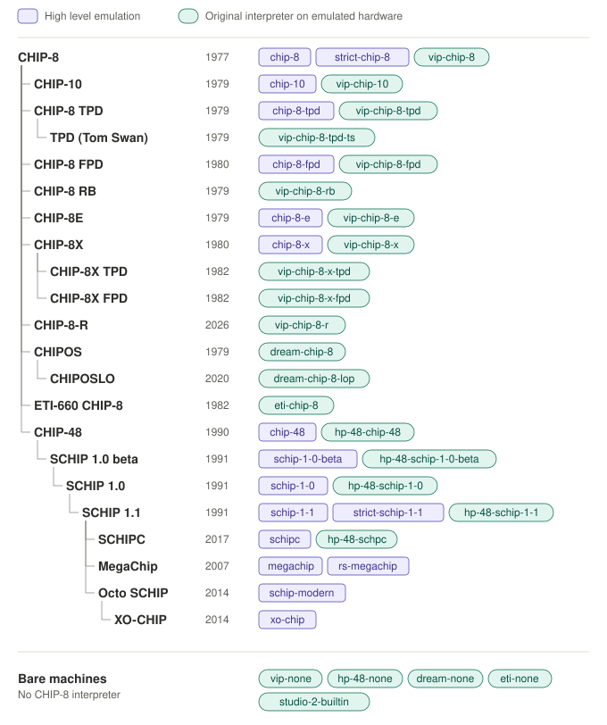

# Cadmium

A CHIP-8 emulation environment written in C++ with a raylib backend.


[](https://github.com/gulrak/cadmium/actions/workflows/build_cmake.yml)
[](https://github.com/gulrak/cadmium/tree/v2.0.0)

<!-- TOC -->
* [Cadmium](#cadmium)
  * [Introduction](#introduction)
  * [Online Version](#online-version)
  * [Features](#features)
    * [Supported CHIP-8 variants](#supported-chip-8-variants)
    * [Multi Architecture Debugging](#multi-architecture-debugging)
    * [Quirks](#quirks)
    * [Keyboard Shortcuts](#keyboard-shortcuts)
  * [Command-line](#command-line)
  * [Versioning](#versioning)
  * [Compiling from Source](#compiling-from-source)
    * [Linux / macOS](#linux--macos)
    * [Windows](#windows)
    * [Build for Web](#build-for-web)
  * [Used Resources](#used-resources)
    * [Information](#information)
    * [Other Emulators used for Verification](#other-emulators-used-for-verification)
    * [Libraries](#libraries)
  * [Special Credits](#special-credits)
  * [FAQ](#faq)
    * [Why the name Cadmium?](#why-the-name-cadmium)
    * [Why the pixel look?](#why-the-pixel-look)
    * [Which font is that?](#which-font-is-that)
<!-- TOC -->

## Introduction

CHIP-8 is maybe the first breed of what is today called a "fantasy console".
The first opcode interpreter was written by Joseph Weisbecker for the
"COSMAC" CDP1802 cpu that he developed at RCA and was used in machines like 
e.g. the COSMAC VIP and the Telmac 1800. 

CHIP-8 is today seen as the "Hello world" of emulators, so the  first
suggestion if someone wants to get into emulator coding is to write a CHIP-8
the get the feeling for it. I already had done some work on emulators and
wrote my own implementation of a Commodore 64 emulator in C++, so one could
say that I had no reason to actually make a CHIP-8 one, but on a longer
weekend off, I stumbled across the topic, I knew the system from my trusty
old HP-48GX, during my study times in the 1990s, so I felt it would be fun to
try to cobble an implementation together in a few hours.
It worked quite well, and as I was using raylib for some tools and took part
in a raylib game jam, I saw this as a good fit.


I had so much fun with this project that I added emulation of the original
COSMAC VIP and the DREAM6800 to the project, to allow using those to run
the historical CHIP-8 interpreters from the past and also to allow execution
of hybrid CHIP-8 programs that contain a mix of CHIP-8 and assembly subroutines
using the rarely supported `0nnn` opcode. So this project explores
the corners of historic CHIP-8 as well and sometimes goes a bit beyond it.

## New in Cadmium 2.0

A short tour of what came with 2.0 (all screenshots are the window content of Cadmium 2.0.0):

<table>
<tr>
<td width="50%"></td>
<td width="50%"></td>
</tr>
<tr>
<td colspan="2">Known programs get their palette and settings from Cadmium's program database, like the
XO-CHIP games <i>Skyward</i> (Jackie Kircher, 2016) and <i>Into the GarlicScape</i> (John Earnest, 2020).</td>
</tr>
<tr>
<td width="50%"></td>
<td width="50%"></td>
</tr>
<tr>
<td><i>MegaInvaders</i> on the <code>megachip</code> preset, it also runs on <code>rs-megachip</code>, the
emulation of the original RS-M8001 interpreter from 2007.</td>
<td><i>Spacefight 2091!</i> (Carsten Soerensen, 1992) on the original SUPER-CHIP 1.1, running on an
emulated HP-48SX with its LCD (<code>hp-48-schip-1-1</code>).</td>
</tr>
<tr>
<td width="50%"></td>
<td width="50%"></td>
</tr>
<tr>
<td colspan="2">The new ETI-660 emulation with the colours of its CDP1864 and the CRT effect: the hybrid
games <i>Wipeout</i> (W.F. Kreykes, 1982) and <i>Kong660</i> (T. Parish, 1984) on <code>eti-chip-8</code>.</td>
</tr>
<tr>
<td width="50%"></td>
<td width="50%"></td>
</tr>
<tr>
<td><i>DREAM Invaders</i>, a native M6800 program on the DREAM6800 (<code>dream-none</code>) with
the CRT effect.</td>
<td>The built-in Bowling of the RCA Studio II (<code>studio-2-builtin</code>, still a preview) with
the CRT effect.</td>
</tr>
</table>

## Online Version

Emscripten builds are available here for testing:
* https://chip8.gulrak.net/cadmium - This is the most current version

Simply drag rom files (`.ch8`, `.hc8`, `.ch10`, `.c8h`, `.c8e`, `.c8x`, `.sc8`, `.mc8`, `.xo8`) or
Octo sources (`.8o`), or Octo cartridges (`.gif`), or even COSMAC VIP programs
(`.bin` or `.ram`) onto the window to load them.

Builds with the library can open it with a search, so a search result can be shared as a link, for example
[`?search=uses+5xy2+or+uses+5xy3`](https://chip8.gulrak.net/cadmium/?search=uses+5xy2+or+uses+5xy3). The link
button next to the search field copies such a link, in the desktop version too, so a search done locally can be
shared. The desktop version takes the same search with `--search "uses 5xy2 or uses 5xy3"`, and with `--list` it
prints the ROMs found instead of opening a window.

## Features

The emulation behavior used in Cadmium is based on opcode information documented
in [the opcode table](https://chip8.gulrak.net), various VIPER magazine issues,
the [CHIP-8 extensions and compatibility](https://chip-8.github.io/extensions/) pages
and tests on various emulators and the HP-48SX/HP-48GX calculator implementations
as well as analyzing the historic interpreters' code and running them on COSMAC
VIP and DREAM6800 (but both emulated, as I sadly don't have access to real hardware
of those yet).

### Supported CHIP-8 variants

The emulation is based on different emulation cores and, depending on the core,
on a set of "quirks" named options that go along with the core. To lessen the
burden to remember the combinations, Cadmium uses "Behavior Presets" to combine
a core, some settings and set of quirks to easily switch between CHIP-8 variants.
The naming conventions adapted are based on the list put together by
_Tobias V. Langhoff_ at https://chip-8.github.io/extensions/ and for the
classic COSMAC VIP based variants it is mainly based on the VIPER magazine where
those interpreter variants where published.

The Supported presets are (possible specific file extensions in parentheses):

| Preset | Extensions/Mode | Description | Year | Done |
|:-------|:---------------:|:------------|:----:|:----:|
| **Generic** | **HLE** | **Emulation based on generic non-hardware-based cores** | |
| chip-8 | .ch8 | The classic CHIP-8 for the COSMAC VIP by Joseph Weisbecker | 1977 | ✓ |
| chip-8-tpd | - | CHIP-8 with two page display (64x64), from #VIPER-V1-I3, by Andy Modla and Jef Winsor, files with its extensions still default to `vip-chip-8-tpd` | 1979 | ✓ |
| chip-8-fpd | - | CHIP-8 with four page display (64x128), from #VIPER-V2-I6, by Tom Swan, files with its extensions still default to `vip-chip-8-fpd` | 1980 | ✓ |
| chip-10 | .ch10 | 128x64 CHIP-8 from #VIPER-V1-I7 and #IpsoFacto-I10, by Ben H. Hutchinson, Jr. | 1979 | ✓ |
| chip-8-e | .c8e | CHIP-8 rewritten and extended by Gilles Detillieux, from #VIPER-V2-8+9 | 1979 | ✓ |
| chip-8-x | .c8x | An official update to CHIP-8 by RCA, requiring the color extension VP-590 and the simple sound board VP-595 | 1980 | ✓ |
| chip-48 | .ch48; .c48 | The initial CHIP-8 port to the HP-48SX by Andreas Gustafsson | 1990 | ✓ |
| schip-1-0-beta | .sc10b | SUPER-CHIP v1.0 beta expansion of CHIP-48 for the HP-48SX with 128x64 hires mode by Erik Bryntse | 1991 | ✓ |
| schip-1-0 | .sc10 | SUPER-CHIP v1.0 expansion of CHIP-48 for the HP-48SX with 128x64 hires mode by Erik Bryntse | 1991 | ✓ |
| schip-1-1 | .sc8; .sc11 | SUPER-CHIP v1.1 expansion of CHIP-48 for the HP-48SX with 128x64 hires mode by Erik Bryntse | 1991 | ✓ |
| schipc | .scc | SUPER-CHIP compatibility fix for the HP-48SX by Chromatophore | 2017 | ✓ |
| schip-modern | .scm | Modern SUPER-CHIP interpretation as done in Octo by John Earnest | 2014 | ✓ |
| megachip | .mc8 | MegaChip as specified by Martijn Wanting, Revival-Studios | 2007 | ✓ |
| xo-chip | .xo8 | A modern extension to SUPER-CHIP supporting colors and actual sound first implemented in Octo by John Earnest | 2014 | ✓ |
| strict-chip-8 | .ch8; .c8vip | Cycle exact high-level emulation of the classic CHIP-8 that came from Joseph Weisbecker on a COSMAC VIP | 1977 | ✓ |
| strict-schip-1-1 | .sc8; .sc11 | Cycle exact high-level emulation of SUPER-CHIP 1.1 as it runs on an HP-48SX | 1991 | ✓ |
| rs-megachip | .ch8; .mc8 | RS-M8001 implementation (original bugs, checked bounds) | 2007 | ✓ |
| **<nobr>COSMAC VIP</nobr>** | **LLE** | **Emulation of an RCA COSMAC VIP** | |
| vip-none | .bin; .hex; .ram; .raw; .cos | Raw COSMAC VIP without any CHIP-8 preloaded | 1977 | ✓ |
| vip-chip-8 | .ch8; .c8vip; .hc8 | The classic CHIP-8 that came from Joseph Weisbecker | 1977 | ✓ |
| vip-chip-10 | .ch10; .c10 | 128x64 CHIP-8 with hardware modifications, from #VIPER-V1-I7 and #IpsoFacto-I10, by Ben H. Hutchinson, Jr. | 1979 | ✓ |
| vip-chip-8-rb | .c8rb | CHIP-8 modification with relative branching (BFnn, FBnn), from #VIPER-V2-I1, by Wayne Smith | 1979 | ✓ |
| vip-chip-8-tpd | .c8tpd; .c8h | CHIP-8 with two page display (64x64), from #VIPER-V1-I3, by Andy Modla and Jef Winsor | 1979 | ✓ |
| vip-chip-8-tpd-ts | .c8tpdts | CHIP-8 with two page display (64x64), from PIPS for VIPS, originally by Andy Modla and Jef Winsor, modified by Tom Swan | 1979 | ✓ |
| vip-chip-8-fpd | .c8fpd | CHIP-8 with four page display (64x128), from #VIPER-V2-I6, by Tom Swan | 1980 | ✓ |
| vip-chip-8-x | .c8x | An official update to CHIP-8 by RCA, requiring the color extension VP-590 and the simple sound board VP-595 | 1980 | ✓ |
| vip-chip-8-x-tpd | .c8xtpd | A modified version of CHIP-8X to use two page display (64x64), from #VIPER-V4-I3, by Andy Modle and Jef Winsor | 1982 | ✓ |
| vip-chip-8-x-fpd | .c8xfpd | A modified version of CHIP-8X for the four page display mode (64x128), from #VIPER-V4-I3, by Tom Swan, sadly not actually working as described due to an implementation bug | 1982 | ✓ |
| vip-chip-8-e | .c8e | CHIP-8 rewritten and extended by Gilles Detillieux, from #VIPER-V2-8+9 | 1979 | ✓ |
| vip-chip-8-r | .c8r | CHIP-8R, a research variant with PC relative jumps (BBnn, BFnn), calls through I (BC00) and 16 bit I loads (F000 nnnn) for programs beyond 4k, also supported by Chiplet | 2026 | ✓ |
| **HP-48SX** | **LLE** | **Emulation of a HP-48SX Calculator** | |
| hp-48-none | .hp; .hp48 | Raw HP-48SX, needs HP's revision E ROM, the built-in replacement ROM only runs the interpreters | 1990 | ✓ |
| hp-48-chip-48 | .ch48; .c48 | Original CHIP-48 on HP-48SX | 1990 | ✓ |
| hp-48-schip-1-0-beta | .sc10b | SUPER-CHIP 1.0 beta on HP-48SX | 1991 | ✓ |
| hp-48-schip-1-0 | .sc10 | SUPER-CHIP 1.0 on HP-48SX | 1991 | ✓ |
| hp-48-schip-1-1 | .sc8; .sc11 | SUPER-CHIP 1.1 on HP-48SX | 1991 | ✓ |
| hp-48-schpc | .sc8; .scc | SUPER-CHIP compatibility interpreter on HP-48SX | 2017 | ✓ |
| **DREAM 6800** | **LLE** | **Emulation of a DREAM6800 system** | |
| dream-none | .bin; .hex; .ram; .raw | Raw DREAM6800 (loading to 0x200, unless .hex, and running it there) | 1979 | ✓ |
| dream-chip-8 | .bin; .hex; .ram; .raw | CHIP-8 DREAM6800 (loading to 0x200, unless .hex, and running 0xC000) | 1979| ✓ |
| <nobr>dream-chip-8-lop</nobr> | .bin; .hex; .ram; .raw | CHIP-8 with logical operators on DREAM6800 (loading to 0x200, unless .hex, and running 0xC000) | 2020 | ✓ |
| **ETI-660** | **LLE** | **Emulation of a ETI-660** | |
| eti-none | .et660; .bin; .hex; .ram; .raw | Raw ETI660 | 1982 | ✓ |
| eti-chip-8 | .c8eti | CHIP-8 on the ETI-660 (64x48) | 1982 | ✓ |
| **RCA Studio II** | **LLE** | **Emulation of an RCA Studio II** | |
| studio-2-builtin | - | RCA Studio II with its built-in games (pad A on keys 1-9 and 0), still more of a preview | 1977 | WIP |

**NOTE:** Be aware that are no established standard file extension beyond `.ch8` in the CHIP-8 world. Different emulators come with files
with different conventions, so this project used existing ones where they seemed fitting and invented their own where
none where found. You can always use `.ch8`, for files known to Cadmium (about 1100 are known by it), this will
work seamlessly. For programs undetected, the settings screen allows to remember a configuration for a file. Like known
roms, it is only based on the SHA1 of the content, so as long as any valid extension is used the detection will work.
For undetected files with a specific extension that multiple variants support, the first one in the order above will be
used.

The family tree below shows where the variants came from and which presets implement
each of them, either as high level emulation or as the original interpreter running on
the emulated hardware:

<p align="center"></p>

### Roadmap of upcoming variants that are currently in development (no promises on a date):

The DREAM6800, ETI-660 and HP-48SX hardware emulations of the earlier roadmap are done (see the
table above), the RCA Studio II is still a preview. Still planned:

* Hardware emulation of "enough of" an Amiga (just enough to faithfully run Paul Hayters CHIP-8):
  * `amiga-chip-8`


----

With `strict-chip-8` Cadmium might be the first high-level emulator that has
a core that can execute CHIP-8 with the behavior and timing of the initial
VIP CHIP-8 interpreter without actually emulating the actual COSMAC VIP. While
this core, like other HLE emulators, can not execute machine subroutines, it
emulates the exact timing behavior of every instruction and the overall frame
timing to reach cycle exact accuracy compared to the real machine. The main
difference to the `vip-chip-8` preset is, that this one needs quite less host
CPU resources, but as said, can't run hybrid programs.

The `strict-schip-1-1` core does the same for SUPER-CHIP 1.1 as it runs on the
HP-48SX, based on the measured timing of the interpreter, optionally with the
HP-48SX display emulation, without the cost of emulating the calculator.

The `schipc` preset is a more generic variant that is similar to
Chromatophore's SCHPC/GCHPC variants of SCHIP1.1 to allow more modern games
(often developed on Octo) that target SuperCHIP to run without tweaking some
quirks that, while correct for the original SCHIP1.1, are not common in modern
programs.

The `schip-modern` preset is more or less Octo's interpretation of SUPER-CHIP
and what Timendus test suite v4.1 checks for as modern SCHIP.

The `vip-*` presets activate a core that is emulating a COSMAC VIP driven by a
CDP1802 CPU with 4k RAM (configurable up to 32k), to execute original CHIP-8
interpreter variants to allow more accurate emulation of classic CHIP-8 and even
allow hybrid roms (`.hc8`) that contain CDP1802 parts to execute on Cadmium.
The available behaviors are classic CHIP-8, CHIP-10, CHIP-8 with relative
branching, CHIP-8 Two Page Display (TPD, also Tom Swan's version),
HI-RES-CHIP-8 (four page display, FPD), CHIP-8E, CHIP-8X with the _VP-590 Color
Board_ and the _VP-595 Simple Sound Board_ attached, as well as a TPD and a
HI-RES version of 8X using that hardware, and the CHIP-8R research variant.
With `vip-none` Cadmium runs a raw COSMAC VIP without any CHIP-8 interpreter,
to load and run games and programs made for the VIP that don't use CHIP-8.

The `hp-48-*` presets activate a core that is emulating an HP-48SX with its
Saturn CPU, running the original CHIP-48, SUPER-CHIP 1.0 beta, 1.0, 1.1 and
Chromatophore's SCHPC interpreters, assembled from source (SUPER-CHIP 1.0 beta,
1.1 and SCHPC are source reconstructions from the binaries, as the originals are
lost).  Cadmium comes with its own clean-room replacement ROM for it, so the
interpreters run in every build, including the web version, but it is not a
calculator, so `hp-48-none` needs HP's revision E ROM. The debugger works on the
CHIP-8 level as well as on the Saturn CPU.

The `dream-chip-8` preset activates a core that is emulating a DREAM6800
driven by an M6800 CPU with 4k RAM (or 2k), to execute the original CHIP-8 CHIPOS
kernel and run an accurate emulation of DREAM6800 CHIP-8, `dream-chip-8-lop`
uses CHIPOSLO with its logical operators instead. This core also allows hybrid
roms that use machine code parts, and `dream-none` runs native M6800 programs
without CHIPOS.

The `eti-chip-8` preset emulates an ETI-660 (CDP1802 with CDP1864 video and
sound) running its 64x48 CHIP-8, `eti-none` the raw machine.

The `studio-2-builtin` preset emulates an RCA Studio II running its built-in
games, this is still more of a preview.

### Multi Architecture Debugging

Cadmium allows for those presets, that emulate actual hardware, to debug
seamlessly on the CHIP-8 opcode level or the backend CPU assembly level. Here
the same program, Timendus' Corax+ opcode test, runs on the original
interpreters of three different machines:

<table>
<tr>
<td width="50%"></td>
<td width="50%"></td>
</tr>
<tr>
<td>COSMAC VIP (<code>vip-chip-8</code>) on the CHIP-8 level</td>
<td>The same moment on the CDP1802 level of the VIP's CHIP-8 interpreter</td>
</tr>
<tr>
<td width="50%"></td>
<td width="50%"></td>
</tr>
<tr>
<td>HP-48SX with SUPER-CHIP 1.1 (<code>hp-48-schip-1-1</code>) on the Saturn level</td>
<td>DREAM6800 with CHIPOSLO (<code>dream-chip-8-lop</code>) on the M6800 level</td>
</tr>
</table>

Breakpoints and single stepping works in both views, the selected instruction
tab defines the logical entity the debug buttons work on, the register view
shows the registers of that entity. Breakpoints of the hidden entity still
work and the tab switches to the entity that hit the breakpoint.

Breakpoints have a break condition, a log format and a log condition, all
editable in the breakpoint tab. An empty condition always breaks, an empty
log condition logs whenever the breakpoint breaks. Conditions are expressions
using the registers of the CPU (`v0`-`vf`, `v[n]`, `i`, `pc`, `sp`, `dt`, `st`
for CHIP-8) and `ram[addr]`, with decimal, `0x` hex or `0b` binary numbers and
C operators (`+ - * / % << >> < <= > >= == != & ^ | && || ! ~`). Labels and
constants of the loaded Octo source can be used too, as long as their names are
C identifiers (`ram[data+1]`, `v0 == LIMIT`). The log format is text with
`{expression}` or `{expression:spec}` placeholders, `spec` being a
[fmt](https://fmt.dev) format spec like `02x` for the value, or an Octo monitor
field like `%2i` that reads bytes from memory at the value as address:
`{data:%2i}` shows two bytes at `data` as a number, `{i:%4x}` four bytes at `I`
in hex.

The Octo `:breakpoint` directive sets these from its text:

| Directive                              | Breaks              | Logs              |
|----------------------------------------|---------------------|-------------------|
| `:breakpoint "frame-done"`             | always              | `frame-done`      |
| `:breakpoint "hit v0={v0} i={i:04x}"`  | always              | `hit v0=3 i=0300` |
| `:breakpoint "v0 == 3"`                | when `v0` is 3      | `v0 == 3`         |
| `:breakpoint "v0 == 3 ? i={i:04x}"`    | when `v0` is 3      | `i=0300`          |
| `:breakpoint "v0 == 3 ? {data:%2x}"`   | when `v0` is 3      | `1234`            |

The text is split at the first `?` outside of a placeholder, but only if the
part before it is a valid expression, so a plain name with a `?` stays a name.

The Watch tab next to the breakpoints shows values that are updated while the
program runs. The Octo `:monitor` directives of the compiled source come first
and look like in Octo: `:monitor data 4` shows four bytes from the label
`data`, `:monitor v2 3` the registers `v2` to `v4`, and a format like
`:monitor pos "x:%i y:%i"` reads consecutive bytes with `%[bytes]i` (decimal),
`x` (hex), `b` (binary) and `c` (7 bit ASCII). As a Cadmium extension the text
of a monitor format can have the `{...}` placeholders of the log formats, like
`:monitor pos "x:%i y:%i speed {SPEED}"`, also without any `%` field
(`:monitor pos "{pos:%2x} at {pos:04x}"`), but Octo itself can't assemble the
latter and shows the braces of the former as they are. Below the monitors,
watches can be added in the tab, either an expression like `ram[i] + v1` or a
log format like `pos {ram[i]:02x}` with the same syntax as breakpoints.

**Note:** Be aware, that in COSMAC VIP 1802 mode, while breakpoints and single
stepping works fine, there is no step-over/step-out support as there is no
defined way of the 1802 CPU to enter subroutines and return, and no stack in
the sense most other CPUs have it. The M6800 debugging of the DREAM6800 side
has those features enabled, as have all CHIP-8 modes, even the VIP one.

### Quirks

Emulation uses a number of configurable "quirks" or options, to allow a wide
range of roms to work with it. Contrary to some other sources, _Cadmium_ sees 
the initial original VIP behavior as the reference, so disabling all
following options gives a basic VIP CHIP-8:
* `8xy6`/`8xyE` just shift Vx
* `8xy1`/`8xy2`/`8xy3` don't reset VF
* `Fx55`/`Fx65` increment I only by x
* `Fx55`/`Fx65` don't increment I
* `Bxnn`/`jump0` uses Vx
* wrap sprite pixels
* `Dxyn` doesn't wait for vsync
* Lores `Dxy0` draws with 0(classic CHIP-8)/8/16 pixel width
* `Dxyn` uses SCHIP1.1 collision logic
* SCHIP lores drawing
* Half-pixel lores scroll
* Mode change clears screen
* 128x64 hires support
* only 128x64 mode
* multicolor support
* Cyclic stack
* Extended display wait
* XO-CHIP sound engine


### Keyboard Shortcuts

| Function      |          Windows/Linux           |              macOS               |
|:--------------|:--------------------------------:|:--------------------------------:|
| New           |  <kbd>Ctrl</kbd> + <kbd>O</kbd>  |  <kbd>Cmd</kbd> + <kbd>O</kbd>   |
| Open File     |  <kbd>Ctrl</kbd> + <kbd>O</kbd>  |  <kbd>Cmd</kbd> + <kbd>O</kbd>   |
| Save File     |  <kbd>Ctrl</kbd> + <kbd>S</kbd>  |  <kbd>Cmd</kbd> + <kbd>S</kbd>   |
| Key Map       |  <kbd>Ctrl</kbd> + <kbd>K</kbd>  |  <kbd>Cmd</kbd> + <kbd>K</kbd>   |
| Quit          |  <kbd>Ctrl</kbd> + <kbd>Q</kbd>  |  <kbd>Cmd</kbd> + <kbd>Q</kbd>   |
| **Execution** |                                  |                                  |
| Run/Play      |          <kbd>F5</kbd>           |          <kbd>F5</kbd>           |
| Stop/Pause    | <kbd>Shift</kbd> + <kbd>F5</kbd> | <kbd>Shift</kbd> + <kbd>F5</kbd> |
| Step Over     |          <kbd>F8</kbd>           |          <kbd>F8</kbd>           |
| Step Into     |          <kbd>F7</kbd>           |          <kbd>F7</kbd>           |
| Step Out      | <kbd>Shift</kbd> + <kbd>F7</kbd> | <kbd>Shift</kbd> + <kbd>F7</kbd> |
| **Editor**    |                                  |                                  |
| Find          |  <kbd>Ctrl</kbd> + <kbd>F</kbd>  |  <kbd>Cmd</kbd> + <kbd>F</kbd>   |
| Replace       |  <kbd>Ctrl</kbd> + <kbd>R</kbd>  |  <kbd>Cmd</kbd> + <kbd>R</kbd>   |
| Copy          |  <kbd>Ctrl</kbd> + <kbd>C</kbd>  |  <kbd>Cmd</kbd> + <kbd>C</kbd>   |
| Cut           |  <kbd>Ctrl</kbd> + <kbd>X</kbd>  |  <kbd>Cmd</kbd> + <kbd>X</kbd>   |
| Paste         |  <kbd>Ctrl</kbd> + <kbd>X</kbd>  |  <kbd>Cmd</kbd> + <kbd>X</kbd>   |


## Command-line

Cadmium allows to select the CHIP-8 variant on startup via the preset parameter and quirk
options. For that to work you need to give the preset first and then each quirk option
can either implicitly flip the quirk to the negated one of the preset, or you can use
them with an optional `true`, `on`, `yes`  for activating the quirk or `false`, `off` or
`no` to disable it. For example `cadmium -p chip8 --instant-dxyn` will start with a
classic CHIP-8 that does not wait for vertical blank on sprite draws. 

```
USAGE: cadmium [options] ...
OPTIONS:

General Options:
  --custom-palette <arg>
    Set the colors of the palette, as comma separated list like "#000000,#FFFFFF,..."

  --draw-dump
    Dump screen after every draw when in trace mode.

  --dump-interpreter <arg>
    Dump the given interpreter in a local file named '<interpreter>.ram' and exit

  --dump-screen <arg>
    Export the last headless presentation as an image

  --dump-state <arg>
    Export headless machine state as JSON

  --export-metadata-db <arg>
    Write the library without ROM data and file names to the given file, as starter library for the resources

  --headless
    Run a binary ROM deterministically without a window (generic CHIP-8 core)

  --max-instructions <arg>
    Limit headless instruction steps (default 3000000)

  --opcode-json
    Dump opcode information as JSON to stdout

  --opcode-stats
    Print the opcode statistics of the given ROM files as JSON, analyzed like the library does

  --screen-dump
    When in trace mode, dump the final screen content to the console

  --test-suite-menu <arg>
    Sets 0x1ff to the given value before starting emulation in trace mode, useful for test suite runs.

  --until-presentations <arg>
    Stop after this many display updates; requires --headless

  --update-program-database <arg>
    Compare the library with the given programs.json of the chip-8-database and write programs_<timestamp>.json with the missing programs added

  -b <arg>, --benchmark <arg>
    Run given number of cycles as benchmark

  -c, --compare
    Run and compare with reference engine, trace until diff

  -h, --help
    Show this help text

  -p <arg>, --preset <arg>
    Select one of the following available preset:
        Default HLE CHIP-8 emulation:
            chip-8 - The classic CHIP-8 for the COSMAC VIP by Joseph Weisbecker, 1977 (.ch8)
            chip-8-tpd - CHIP-8 with two page display (64x64), from #VIPER-V1-I3, by Andy Modla and Jef Winsor, 1979 ()
            chip-8-fpd - CHIP-8 with four page display (64x128), from #VIPER-V2-I6, by Tom Swan, 1980 ()
            chip-10 - 128x64 CHIP-8 from #VIPER-V1-I7 and #IpsoFacto-I10, by Ben H. Hutchinson, Jr., 1979 (.ch10)
            chip-8-e - CHIP-8 rewritten and extended by Gilles Detillieux, from #VIPER-V2-8+9 (.c8e)
            chip-8-x - An official update to CHIP-8 by RCA, requiring the color extension VP-590 and the simple sound board VP-595, 1980 (.c8x)
            chip-48 - The initial CHIP-8 port to the HP-48SX by Andreas Gustafsson, 1990 (.ch48;.c48)
            schip-1-0-beta - SUPER-CHIP v1.0 beta expansion of CHIP-48 for the HP-48SX with 128x64 hires mode by Erik Bryntse, 1991 (.sc10b)
            schip-1-0 - SUPER-CHIP v1.0 expansion of CHIP-48 for the HP-48SX with 128x64 hires mode by Erik Bryntse, 1991 (.sc10)
            schip-1-1 - SUPER-CHIP v1.1 expansion of CHIP-48 for the HP-48SX with 128x64 hires mode by Erik Bryntse, 1991 (.sc8;.sc11)
            schipc - SUPER-CHIP compatibility fix for the HP-48SX by Chromatophore, 2017 (.scc)
            schip-modern - Modern SUPER-CHIP interpretation as done in Octo by John Earnest, 2014 (.scm)
            megachip - MegaChip as specified by Martijn Wanting, Revival-Studios, 2007 (.mc8)
            xo-chip - A modern extension to SUPER-CHIP supporting colors and actual sound first implemented in Octo by John Earnest, 2014 (.xo8)
        First cycle exact HLE emulation of CHIP-8 on a COSMAC VIP:
            strict-chip-8 - The classic CHIP-8 that came from Joseph Weisbecker, 1977 (.ch8;.c8vip)
        First cycle exact HLE emulation of SCHIP 1.1 on an HP-48SX:
            strict-schip-1-1 - Cycle exact SUPER-CHIP 1.1 as it runs on an HP-48SX, 1991 (.sc8;.sc11)
        Faithful RS-M8001 interpreter with checked bounds:
            rs-megachip - 2007 RS-M8001 implementation (original bugs, checked bounds) (.ch8;.mc8)
        Hardware emulation of a COSMAC VIP:
            vip-none - Raw COSMAC VIP without any CHIP-8 preloaded (.bin;.hex;.ram;.raw;.cos)
            vip-chip-8 - The classic CHIP-8 that came from Joseph Weisbecker, 1977 (.ch8;.c8vip;.hc8)
            vip-chip-10 - 128x64 CHIP-8 with hardware modifications, from #VIPER-V1-I7 and #IpsoFacto-I10, by Ben H. Hutchinson, Jr., 1979 (.ch10;.c10)
            vip-chip-8-rb - CHIP-8 modification with relative branching (BFnn, FBnn), from #VIPER-V2-I1, by Wayne Smith, 1979 (.c8rb)
            vip-chip-8-tpd - CHIP-8 with two page display (64x64), from #VIPER-V1-I3, by Andy Modla and Jef Winsor, 1979 (.c8tpd;.c8h)
            vip-chip-8-tpd-ts - CHIP-8 with two page display (64x64), from PIPS for VIPS, originally by Andy Modla and Jef Winsor, modified by Tom Swan, 1979 (.c8tpdts)
            vip-chip-8-fpd - CHIP-8 with four page display (64x128), from #VIPER-V2-I6, by Tom Swan, 1980 (.c8fpd)
            vip-chip-8-x - An official update to CHIP-8 by RCA, requiring the color extension VP-590 and the simple sound board VP-595, 1980 (.c8x)
            vip-chip-8-x-tpd - A modified version of CHIP-8X to use two page display (64x64), from #VIPER-V4-I3, by by Andy Modle and Jef Winsor (.c8xtpd)
            vip-chip-8-x-fpd - A modified version of CHIP-8X for the four page display mode (64x128), from #VIPER-V4-I3, by Tom Swan, sadly not actually working as described due to an implementation bug (.c8xfpd)
            vip-chip-8-e - CHIP-8 rewritten and extended by Gilles Detillieux, from #VIPER-V2-8+9 (.c8e)
            vip-chip-8-r - CHIP-8 research variant with PC relative jumps (BBnn, BFnn), calls through I (BC00) and 16 bit I loads (F000 nnnn) instead of BMMM, for programs beyond 4k (.c8r)
        Hardware emulation of an HP-48SX:
            hp-48-none - Raw HP-48SX (.hp;.hp48)
            hp-48-chip-48 - Original CHIP-48 on HP-48SX (.ch48;.c48)
            hp-48-schip-1-0-beta - SUPER-CHIP 1.0 beta on HP-48SX (.sc10b)
            hp-48-schip-1-0 - SUPER-CHIP 1.0 on HP-48SX (.sc10)
            hp-48-schip-1-1 - SUPER-CHIP 1.1 on HP-48SX (.sc8;.sc11)
            hp-48-schpc - SUPER-CHIP compatibility interpreter on HP-48SX (.sc8;.scc)
        Hardware emulation of a DREAM6800:
            dream-none - Raw DREAM6800 (.bin;.hex;.ram;.raw)
            dream-chip-8 - CHIP-8 DREAM6800 (.bin;.hex;.ram;.raw)
            dream-chip-8-lop - CHIP-8 with logical operators on DREAM6800 (.bin;.hex;.ram;.raw)
        Hardware emulation of an ETI660:
            eti-none - Raw ETI660 (.et660;.bin;.hex;.ram;.raw)
            eti-chip-8 - CHIP-8 on the ETI-660 (64x48) (.c8eti)
        Hardware emulation of an RCA Studio II:
            studio-2-builtin - RCA Studio II with its built-in games (pad A on keys 1-9 and 0) ()

  -r, --[no-]run
    if a ROM is given (positional) start it

  -t <arg>, --trace <arg>
    Run headless and dump given number of trace lines

  -v, --version
    Show version information

CHIP-8 GENERIC Options (only available if preset uses default core):
  --[no-]clean-ram
    Clean RAM

  --[no-]crt-effect
    Show the screen like a CRT with visible scan lines (display only)

  --[no-]cubechip-tone
    CubeChip contextual tone

  --[no-]cyclic-stack
    Cyclic stack

  --[no-]dont-reset-vf
    8xy1/8xy2/8xy3 don't reset VF

  --[no-]extended-vblank
    Extended CHIP-8 wait emulation

  --frame-rate <arg>
    Number of frames per second, default 60

  --[no-]half-pixel-scroll
    Half pixel scrolling

  --[no-]hp-48-display
    HP-48SX display emulation

  --[no-]instant-dxyn
    Dxyn doesn't wait for vsync

  --instructions-per-frame <arg>
    Number of instructions per frame, default depends on variant

  --[no-]jump-0-bxnn
    Bxnn/jump0 uses Vx

  --[no-]just-shift-vx
    8xy6/8xyE just shift Vx

  --[no-]load-store-inc-i-by-x
    Fx55/Fx65 increment I by x

  --[no-]load-store-inc-i-by-x-plus-1
    Fx55/Fx65 increment I by x + 1

  --[no-]lores-dxy-0-is-16-x-16
    Lores Dxy0 draws 16 pixel width

  --[no-]lores-dxy-0-is-8-x-16
    Lores Dxy0 draws 8 pixel width

  --memory <arg>
    Size of ram in bytes (2048, 4096, 8192, 16384, 32768, 65536, 16777216)

  --[no-]mode-change-clear
    Mode change clear

  --[no-]schip-11-collision
    Dxyn uses SCHIP1.1 collision

  --[no-]schip-lores-drawing
    HP SuperChip lores drawing

  --[no-]schip-preview-fx-29
    HP SuperChip 1.0 'preview' Fx29

  --screen-rotation <arg>
    Clockwise rotation of the shown screen, for programs played sideways (0, 90, 180, 270)

  --trace-file <arg>
    Trace log file

  --[no-]trace-log
    Enable trace log

  --[no-]wrap-sprites
    Wrap sprite pixels

CHIP-8 STRICT Options (only available if preset uses strict core):
  --[no-]clean-ram
    Delete ram on startup

  --clock-rate <arg>
    Clock frequency, default is 1760640

  --memory <arg>
    Size of ram in bytes (2048, 4096, 8192, 12288, 16384, 32768)

  --[no-]trace-log
    Enable trace log

SCHIP-STRICT Options (only available if preset uses strict core):
  --[no-]clean-ram
    Delete ram on startup

  --[no-]hp-48-display
    HP-48SX display emulation

  --[no-]trace-log
    Enable trace log

RS-M8K1 Options (only available if preset uses default core):
  --[no-]trace-log
    Enable opcode trace

  --[no-]vip-mode
    Original mode-1 behavior, including double shifts

COSMAC-VIP Options (only available if preset uses vip core):
  --[no-]clean-ram
    Delete ram on startup

  --clock-rate <arg>
    Clock frequency, default is 1760640

  --[no-]crt-effect
    Show the screen like a CRT with visible scan lines (display only)

  --memory <arg>
    Size of ram in bytes (2048, 4096, 8192, 12288, 16384, 32768)

  --[no-]trace-log
    Enable trace log

  --[no-]trace-video
    Insert video events into trace log

HP-48SX Options (only available if preset uses hp-48 core):
  --contrast <arg>
    Display contrast (0-31, the calculator default is 11)

  --[no-]fixed-contrast
    Use the Contrast setting instead of the contrast the calculator sets

  --rom <arg>
    HP-48SX ROM asset (sxrom-rev-e, cadmium-hp-48-sx-rom)

DREAM6800 Options (only available if preset uses dream core):
  --[no-]clean-ram
    Delete ram on startup

  --clock-rate <arg>
    Clock frequency, default is 1000000

  --[no-]crt-effect
    Show the screen like a CRT with visible scan lines (display only)

  --memory <arg>
    Size of ram in bytes (2048, 4096)

  --rom-name <arg>
    Rom image name, default c8-monitor (none, chipos, chiposlo)

  --[no-]trace-log
    Enable trace log

ETI660 Options (only available if preset uses eti core):
  --[no-]clean-ram
    Delete ram on startup

  --clock-rate <arg>
    Clock frequency, default is 1773448

  --[no-]crt-effect
    Show the screen like a CRT with visible scan lines (display only)

  --[no-]trace-log
    Enable trace log

STUDIO-II Options (only available if preset uses studio-2 core):
  --[no-]clean-ram
    Delete ram on startup

  --clock-rate <arg>
    Clock frequency, default is 1760640

  --[no-]crt-effect
    Show the screen like a CRT with visible scan lines (display only)

  --[no-]trace-log
    Enable trace log

...
    ROM file or source to load (.bin, .c10, .c48, .c8e, .c8eti, .c8fpd, .c8h, .c8r, .c8rb, .c8tpd, .c8tpdts, .c8vip, .c8x, .c8xfpd, .c8xtpd, .ch10, .ch48, .ch8, .cos, .et660, .hc8, .hex, .hp, .hp48, .mc8, .ram, .raw, .sc10, .sc10b, .sc11, .sc8, .scc, .scm, .xo8)
```

## Versioning

Cadmium uses version numbers to communicate the difference between releases and
work-in-progress builds. Only even patch versions will be used for releases
and odd patch version will only be used for commits while working on  the next
version. So a version like `v1.0.1` can vary in features and behavior as it is
the changing `main` branch head between `v1.0.0` and `v1.0.2`.

## Compiling from Source

_Cadmium_ is written in C++20 and uses CMake as a build solution. To build it,
checkout or download the source.

### Linux / macOS

The Linux build of Cadmium has the same prerequisites that raylib has and as thus
the following packages are expected to be installed:

* **Ubunbtu:** `libasound2-dev libx11-dev libxrandr-dev libxi-dev libgl1-mesa-dev libglu1-mesa-dev libxcursor-dev libxinerama-dev libwayland-dev libxkbcommon-dev`
* **Fedora:** `alsa-lib-devel mesa-libGL-devel libX11-devel libXrandr-devel libXi-devel libXcursor-devel libXinerama-devel libatomic`
* **Arch:** `alsa-lib mesa libx11 libxrandr libxi libxcursor libxinerama`

Additionally, if building for Wayland, one needs `wayland-devel libxkbcommon-devel wayland-protocols-devel`
and add the `-DUSE_WAYLAND=ON` option to the initial CMake call.

For macOS, only the Xcode commandline tools and CMake are needed.

Open a terminal, enter the directory where the code was extracted and run:

```
cmake -S . -B build
```

to configure the project, and

```
cmake --build build
```

to compile it.

### Windows

Currently, _Cadmium_ is not being able to compile with MSVC++ so the recommended
toolchain is [W64devkit](https://github.com/skeeto/w64devkit). I might try to make
it compile on MSVC++, but I am not  working on that in the near future. That being
said, I would not per-se reject PRs helping with this.

```
export PATH="$PATH;C:/Program Files/CMake/bin"
cmake -G"Unix Makefiles" -DCMAKE_C_COMPILER=gcc -DCMAKE_CXX_COMPILER=g++ -DGRAPHICS=GRAPHICS_API_OPENGL_21 -S . -B build-w64dev
```

### Build for Web

This has only been tried on macOS yet, you need emsdk and cmake installed, and
I expect it to work on Linux the same way.

```
cmake -S . -B build -DCMAKE_TOOLCHAIN_FILE=<path-to-emsdk>/emsdk/upstream/emscripten/cmake/Modules/Platform/Emscripten.cmake
cmake --build build
```

Deploy `index.html`, `index.js`, and `index.wasm` as usual.

### HP-48SX Core

The HP-48SX core runs the original CHIP-48 and SUPER-CHIP interpreters on an
emulated HP-48SX. It needs HP's revision E ROM, which is not part of this
repository. Put it as `resources/files/sxrom-rev-e` (the file is in `.gitignore`)
and CMake builds the core and compiles the ROM into Cadmium, on all platforms
excluding the web. Without the ROM, Cadmium is built with the included clean-room
replacement ROM for the HP-48SX is built from the source  at
`src/emulation/hardware/hp48/cadmium-hp48sx-rom.asap`. That ROM only contains
the parts needed to run the interpreters, not the full calculator functionality.
Its implementation was done with the help of Claude Opus 5.5 using my own disassembler
for the analysis and writing a specification, that was then used by me and a
clean session to reconstruct a cycle exact functional replica of these routines.

## Used Resources

### Information

* [Mastering CHIP-8](https://github.com/mattmikolay/chip-8/wiki/Mastering-CHIP%E2%80%908) -
  A great document to start the CHIP-8 emulation journey with (not about how emulators
  work in general)
* [CHIP-8 extensions and compatibility](https://chip-8.github.io/extensions/) - 
  A comprehensive overview of different  CHIP-8 variants that was the initial
  motivator to support many of them, a great overview.
* [HP48-Superchip](https://github.com/Chromatophore/HP48-Superchip) - 
  This repository contains valuable information on the specifics of
  CHIP-48/Super-Chip that go beyond the specification of Super-Chip.


### Other Emulators used for Verification

* [Octo](https://johnearnest.github.io/Octo/) - This has to be the first one named,
  this very user-friendly web based emulation environment sets the standard any
  CHIP-8 emulator that tries to help in development of CHIP-8 programs needs to be
  measured by, and I used it to try out a lot of stuff, it's assembly language is
  the one supported by _Cadmium_.
* [Silicon8](https://github.com/Timendus/silicon8) - While experimenting with
  more than 4 colors in XO-Chip mode this emulator helped to compare the results
  and test the very advanced and resource hungry roms its author has written.


### Libraries

* [raylib](https://www.raylib.com) - the fun game programming library that
  inspired me to write this _(automatically fetched during configuration)_
* [raygui](https://github.com/raysan5/raygui) - the lightweight immediate mode
  gui library for raylib _(contained in my wrapper rlguipp)_
* [c-octo assembler](https://github.com/JohnEarnest/c-octo) - the octo
  assembler for support of generating binaries from [Octo assembler syntax](http://johnearnest.github.io/Octo/docs/Manual.html)
  was originally the base of Chiplets assembler, but it has been very heavily
  reworked and modified, so it is its ancestor but hardly recognizable by now.
  Still, having this was a huge help and it will allways be named as the reference.
* [fmtlib](https://github.com/fmtlib/fmt) - a modern formatting library in
  the style of C++20 std::format _(contained in `external/fmt`)_
* [date](https://howardhinnant.github.io/date/date.html) - A date and time
  library based on the C++11/14/17 &lt;chrono&gt; header _(contained in `external/date`)_
* [json for modern c++](https://github.com/nlohmann/json) - A flexible and
  nice to use JSON implementation _(contained in `external/nlohmann`)_
* [ghc::filesystem](https://github.com/gulrak/filesystem) - An implementation
  of std::filesystem for C++11/14/17/20 that also works on MingW variants
  that don't have a working std::filesystem in C++17 and with better utf8
  support _(automatically fetched during configuration)_
* [zstd](https://github.com/facebook/zstd) - fast compression, used for the
  HP-48SX state files _(automatically fetched during configuration, only with
  the HP-48SX core)_

### HP-48SX CHIP-8 Interpreters

The interpreter sources in `resources/files/hp-chip8` are not covered by
Cadmium's MIT license, they keep their own: noncommercial distribution is
allowed, provided that the copyright message is preserved and modified
versions are clearly marked as such. All four are based on CHIP-48 by
Andreas Gustafsson, their headers describe their history and changes:

* `chip48.asap` - CHIP-48 2.25 by Andreas Gustafsson (1990), slightly modified
  for Cadmium's ASAP assembler
* `schip10.asap` - SUPER-CHIP 1.0 by Erik Bryntse (1991), slightly modified for
  Cadmium's ASAP assembler
* `schip11.asap` - SUPER-CHIP 1.1 by Erik Bryntse (1991), its source is lost,
  this is a reconstruction from the binary and the 1.0 source by Steffen
  "Gulrak" Schümann (2026)
* `schpc.asap` - SCHPC, the SUPER-CHIP compatibility fix by Chromatophore (2018),
  made by patching the 1.1 binary, reconstructed as source by Steffen "Gulrak"
  Schümann (2026)


## Special Credits

Cadmium started as a "Well I guess I should at least implement CHIP-8
once" project, after I already privately had fun writing emulators
But the combined early reactions from the raylib Discord and the
Emulation Development Discord gave me so much fun that I started to
dig more into the subject. So **first of all a big thank you to all
those who pushed me with their nice comments and inspirational
remarks, I can't name you all, but it really did kick off this project**.

I still want to give out some explicit thanks to:

* _Ramon Santamaria (@raysan5)_ - I stumbled across [raylib](https://www.raylib.com/)
  at the end of 2021 and since 2022 I started using it for some experiments and
  then took part in the raylib game jam and had so much fun. Without
  raylib I wouldn't have started this, it was originally a test bed
  for my wrapper of Ramons [raygui](https://github.com/raysan5/raygui) but
  instead became a life of its own.

* _John Earnest (@JohnEarnest)_ - for his great Octo and for XO-Chip,
  while I still would have loved for some things to be different in
  Octo Assembly Syntax, I really appreciate that this new variant
  got CHIP-8 development to a more modern level, made it more
  accessible and together with the great [web based IDE](https://johnearnest.github.io/Octo/)
  gave CHIP-8 a new live and the idea of a yearly [OctoJam](https://itch.io/jam/octojam-9)
  sure helped, pushing it. Thank you for that!\
  His [C-Octo implementation](https://github.com/JohnEarnest/c-octo) of the assembler
  also was the starting point of the assembler in Cadmium and drived
  its assembling capabilities, and its spirit still lives on in the
  now heavily changed and ported to C++ version that is currently used.

* _Tim Franssen (@Timendus)_ - for his
  [CHIP-8 Test Suite](https://github.com/Timendus/chip8-test-suite)
  helped me a great deal in finding issues and get a better understanding of the
  quirks that differentiate the CHIP-8 variants, and for his work
  on a [binary CHIP-8 container](https://github.com/Timendus/chip8-binary-format)
  that could carry emulation parameter allowing easy set-up for roms.

* _@NinjaWeedle_ - for his great help and countless tests to get some
  flesh on the very skinny original MegaChip8 specs to allow actually
  support this exotic CHIP-8 variant and maybe help it to be more
  accepted. This work resulted in his extended
  [MegaChip8 documentation](https://github.com/NinjaWeedle/MegaChip8).

* _@Kouzeru_ - for pushing me into supporting
  [XO-Audio](http://johnearnest.github.io/Octo/docs/XO-ChipSpecification.html#audio)
  and the creative discussions on where to go with future chip variants
  and the cool music he creates on XO-Audio. 

* _Joshua Moss (@Bandock)_ - for motivating me to implement and
  CDP1802 emulation core and getting "Support a real VIP mode"
  onto my todo list and for the interesting
  [HyperChip64](https://github.com/Bandock/hyper_bandchip) ideas.

* _Tobais V. Langhoff (@tobiasvl)_ - for his excellent page on [CHIP-8 extensions
  and compatibility](https://chip-8.github.io/extensions/),
  and for his DREAM6800 emulator [DRÖM](https://github.com/tobiasvl/drom)
  that inspired me to look into the DREAM6800.

* _Michael J Bauer (@M-J-Bauer)_ - for developing the [DREAM6800
  computer](https://www.mjbauer.biz/DREAM6800.htm)
  and CHIPOS, to extend the CHIP-8 world to the [M6800 CPU](https://en.wikipedia.org/wiki/Motorola_6800),
  and for making me learn M6800 assembler and giving his okay to use the CHIPOS rom
  data inside Cadmiums DREAM6800 emulator.


## FAQ

### Why the name Cadmium?
The first time I got into contact with CHIP-8 was with Super-Chip on an
HP-48 calculator during my CS studies. The base of that was the CHIP-48
variant, named after the calculator. I think the reliving of CHIP-8 on
these calculators was one of the things that helped CHIP-8 survive the
time from the seventies until today. _Cadmium_ is an element with the
atomic number of 48 in the periodic table of elements, so that made me
chose it as the name reference for this project.

### Why the pixel look?
_Cadmium_ is about emulating and developing for CHIP-8 and its variants,
a platform that has a resolution of traditionally 64x32 pixel, the
"hires" mode has 128x64 pixels and even MegaChip8 only 256x192 pixels,
so if you hate seeing pixels, this might not be the platform for you. :wink:
Jokes aside, I wanted _Cadmium_ to have an original and recognizable look.
Many emulators use the absolutely great _Dear ImGui_ for the
UI, and the fact that a ready-to-use memory editor exists for it helps
a lot, getting something professionally looking done fast. While there
is nothing wrong with that, and [Dorito](https://github.com/lesharris/dorito)
another CHIP-8 IDE that I only came to know after I already had editor and
assembler working, is a really great example of what can be done that way, I
still think there is not much individually recognizable between the look
of these emulators. One can argue that standardization is a good thing,
and I can see that, I just didn't feel like adding one to the list.
So I guess _Cadmium_ is for people that can appreciate this individuality
and raygui, the raylib extension that is behind many widgets of _Cadmium_
is the way to get this pixel look.

### Which font is that?
_Cadmium_'s UI uses a handmade font heavily inspired by the 5x8 pixel
font integrated in the [Thomson EF936x](https://en.wikipedia.org/wiki/Thomson_EF936x)
video chip that was used in an extension card of the [NDR-Klein-Computer](https://en.wikipedia.org/wiki/NDR-Klein-Computer),
a DIY computer that could be build following a german educational tv
program in the eighties. The font is build in an ASCII file in the
`tools` folder through a commandline tool and the generated array is
embedded into the `src/cadmium.cpp` source file. The chip originally only
has 95 characters and I created the basic set and filled up the latin-1
codepage characters and some additional unicode code points. I think
its historic source and its look add to the unique look and feel of
the _Cadmium_ UI, but I can agree that it is a matter of taste. :wink:
